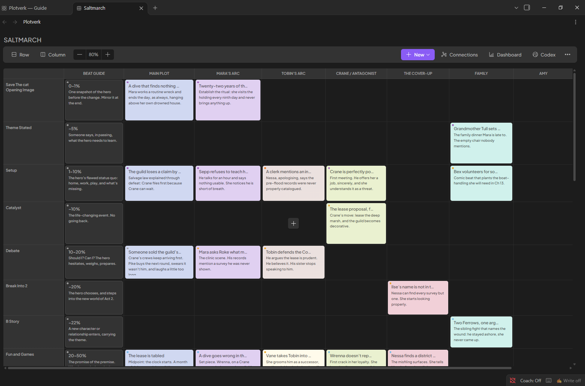
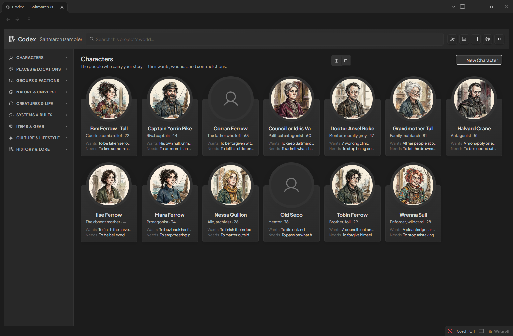
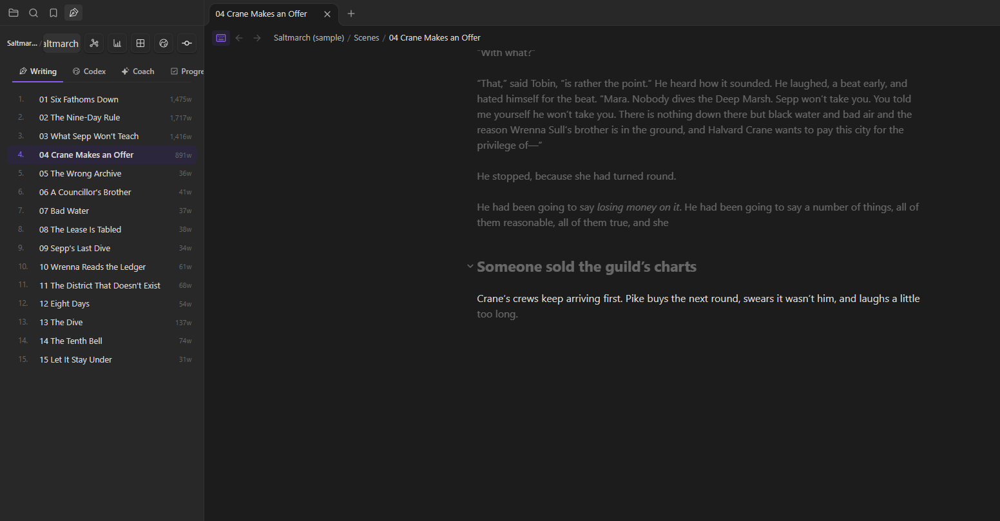
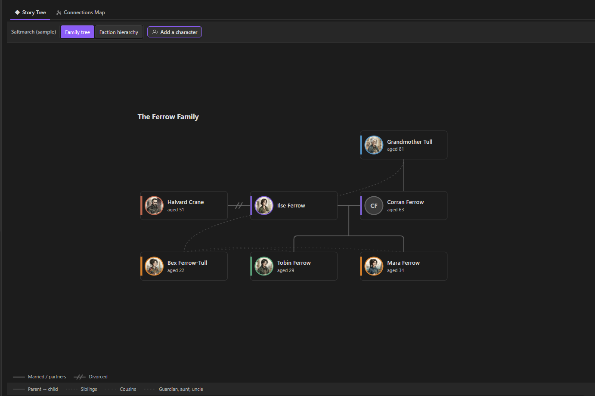
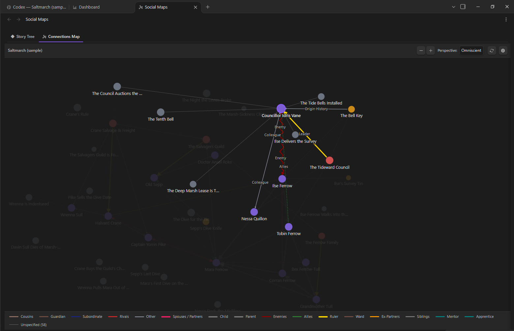
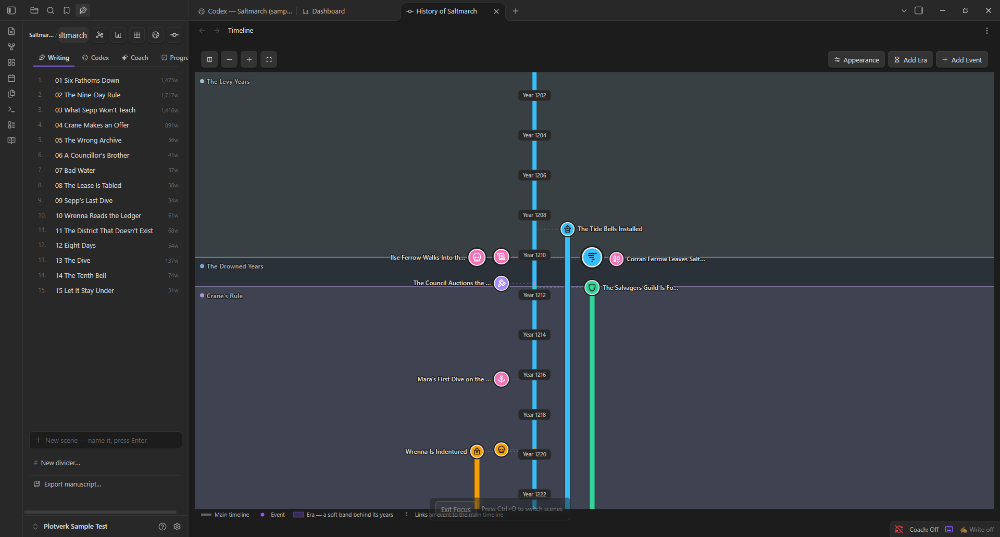
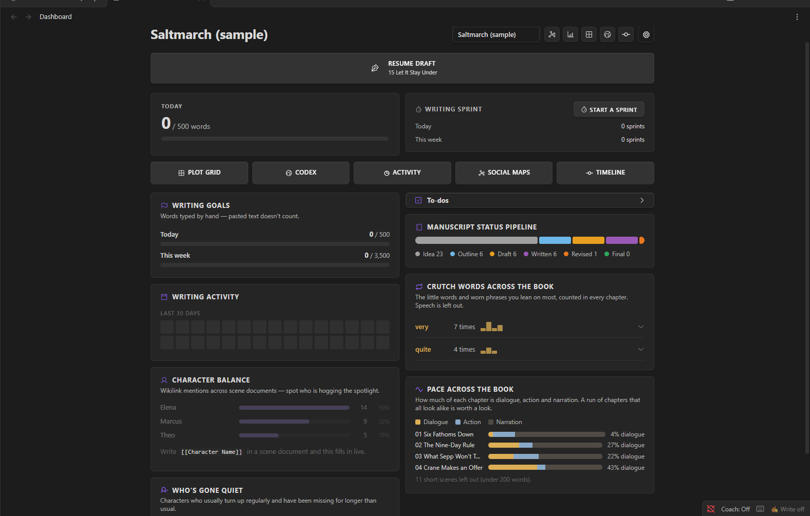

# Plotverk

**Plan your book, build its world and draft it, all in one place inside Obsidian. Free, private, and shaped the way you work.**

## Screenshots

All pictures show *Saltmarch*, the sample story.

**Plot Grid:** A beautiful outline of your storyline in one clear grid screen.

**Story Codex:** Create your world. Every character, place, object and faction in one searchable connected database.

**Writing:** Write distraction-free in a focused typewriter mode.

**Family tree:** Automatically drawn from the relationships in your Codex character pages.

**Connections map:** Get an easy overview of who knows whom, and what ties them together.

**Timeline:** Your world's history in eras and events with your own colors & choice of icons.

**Dashboard:** Keep track of your writing goals and work progress across the whole project.

## Hi from Emma

Hi! I'm Emma, a budding fantasy writer. I built Plotverk for writers and creators like me who want powerful tools without a steep learning curve.

Most writing setups mean installing one plugin for outlining, another for characters, another for word counts, and learning each one separately. I wanted my favorite tools in one place, made to automatically work together, and simple enough that I could just start writing.

Are you a new writer? Plotverk guides you from first idea to finished manuscript with a prose coach and easy-to-use templates, both for your worldbuilding and for planning your story in the Plot Grid.

Experienced author? Focus on what matters! Use a focused typewriter mode and keep your world bible open beside your draft without having to break your workflow.

## Only what you need

Plotverk is built from modules, and you only have to pick the ones you need. Nothing clutters your screen that you didn't ask for.

- **Switch on what you'll use.** Love the Plot Grid but never need a timeline? Leave the timeline off.
- **Change your mind any time.** Turn on a module in the settings when you need it, and off again when you don't.
- **Nothing gets lost.** Switching a module off only hides it. Your notes stay exactly where they are.
- **A head start if you want one.** The first time you open Plotverk, it asks what you write and switches on the tools that fit. Or skip the questions, and everything stays on.

## Plotverk Features - Room to be creative

- **The Plot Grid.** Think of index cards on a wall, just tidier. It helps you plan and track all the parts of your story and you decide what the rows and columns stand for. A column or row can be acts and chapters, or character arcs and plotlines. Your whole book and series overview on one screen.
- **Scene cards.** You can link each scene to its own card. Jot down what happens, who's in it and how far along it is, then drag it to wherever it belongs. Link the card to the scene you're writing, and its first lines show up right on the card, so your plan never drifts away from your draft.
- **The Codex.** A home for your world & everything you invent. Every character, place, faction and magic system gets its own page and everything is automatically connected to the other modules you use. Use Plotverk's helpful pre-made templates with good questions to answer, or create a custom blank sheet or template to save for later use.
- **Dashboard & Progress Helper.** Keep track of your writing goals and task list, get a clear overview of your drafts, run writing sprints and see whether your characters are getting a balanced and fair share of the story and more.
- **Relationship Connections Map.** Watch your world cast come together on a relationship map of who loves, hates, serves or betrays whom. Add your own types of relationships once and it appears on both characters' pages. The map is drawn automatically from the relationships you add in your Codex character pages.
- **Family tree view.** View your characters or factions in clear family trees connected to your Codex. What you change in your Codex shows up in the tree for an easy overview of your world.
- **Timeline.** Create a timeline of your story and world's history using your own color choices and icons and watch it grow with your Codex.
- **Writing.** Your chapters sit in a clear panel beside your draft, in order and easy to rearrange. Typewriter mode clears the screen and helps you focus while keeping the line you're typing in the middle, and a gentle prose coach can point out things worth a second look when you revise. Tip: typewriter mode can be customized to your liking.
- **Finishing.** When the draft is done, Plotverk gathers your chapters into one manuscript: a Word document, an e-book (EPUB), Markdown, or a screenplay.

## Shape the app your way
Plotverk focuses on creativity and customization and lets you decide how much guidance you need, or if you want to start with a blank slate.

Here are some of the ways Plotverk lets you customize it:

The Grid:
- Name your own rows and columns, color your cards and grid in beautiful shades and gradients, and resize anything to your liking.
- Start to plan your project with a guided "beat sheet" for writers like Save the Cat or the Hero's Journey, or from a blank grid, and save your own layouts as templates.

The Codex:
- Create and reuse your own templates in the Codex (World bible) with many different field types to choose from or use the helpful built in templates based on the works of famous authors and industry standards.

Social Maps:
- Make your own relationship types for your social maps in the settings, with your own colors and looks.

Dashboard:
- Never feel overwhelmed. Rearrange or hide the panels on your Dashboard, so it shows only what you truly care about.

## Easy Demo to help you understand how the app works from day one

- We added an optional sample demo called *Saltmarch*, included in the app to show you what an active project could look like. Open it from the Welcome page to look around before you start your own project.
- We've tried to use bright colors and clear descriptions in simple info boxes, and every tool explains itself the first time you meet it. You can always hover over a field to get an explanation of what it does.
- It works on your computer and on your phone.

## Get started

1. In Obsidian, go to **Settings → Community plugins → Browse**, search for **Plotverk**, then click **Install** and **Enable**.
2. Answer the two welcome questions, or skip them.
3. Optional: click **Look at a sample demo first** to explore *Saltmarch*,
4. or click **Start your first project** to begin your own.

Requires Obsidian 1.7.2 or later.

To install by hand instead, download `main.js`, `manifest.json` and `styles.css` from the latest release, put them in the `.obsidian/plugins/plotverk/` folder inside your vault, then reload Obsidian and enable Plotverk.

## Your writing stays yours

Plotverk is free, needs no account and makes no network calls, so it works completely offline within your own privacy. Every page it creates is an ordinary Markdown note in your own vault. You can read it, edit it, sync it and back it up as you like.

## Feedback and bugs

Plotverk is a passion project by Emma Bliss and a work in progress! Found something broken, or missing a feature? Open an issue on GitHub and tell me which Obsidian version you're on and whether you're on a computer or phone. Plotverk is growing, and your feedback is welcome and helps shape what comes next.

## License

Copyright © 2026 Swebliss, Emma Bliss. Plotverk is free to use for any writing, including books you sell.

The code is licensed under the GNU General Public License v3.0. You can read it and learn from it, but anything that copies or builds on it must also be free and open under the same license, with credit to the original.
